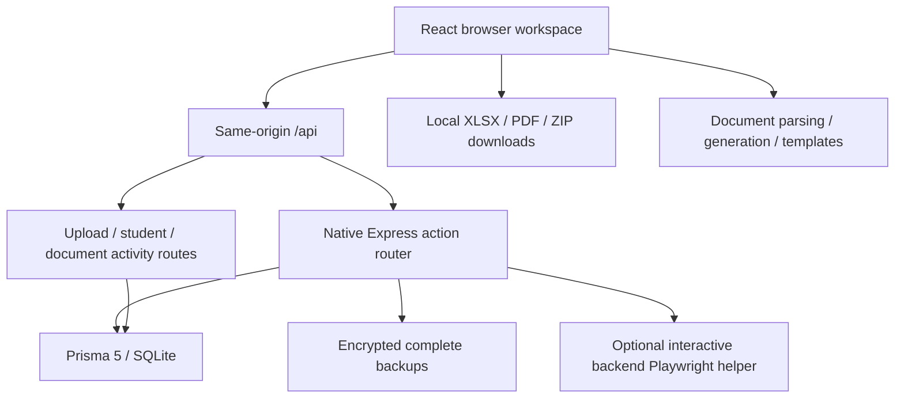

# CEPT project map

Updated 2026-10-28 after official name authority and registration-family name unification. See [CODE_INDEX](docs/CODE_INDEX.md) for exact file/function locations and [README](README.md) for setup. The original source review is preserved as [INITIAL_REVIEW](docs/INITIAL_REVIEW.md), a historical snapshot whose migration findings have since been addressed.

## Architecture

The two operational tabs are named **CEPT Data** and **CEPT Create**.

## Find the feature

Paths are relative to CEPT. Backend abbreviations live under `server/src/` and UI component names under `src/components/`.

| Work area | Primary files |
| --- | --- |
| Boot, route guards and layout | `src/main.jsx`, `src/App.jsx`, `Layout.jsx`, `Sidebar.jsx` |
| HTTP and shared query state | `src/api.js`, `src/hooks/useApiQuery.js`, `vite.config.js` |
| Password / portal SSO login | `LoginPage.jsx`, `SSOHandler.jsx`, `src/context/AuthContext.jsx`, `src/context/useAuth.js`, `controllers/authHandlers.js` |
| Dashboard and enrollment helper | `HomePage.jsx`, `controllers/adminHandlers.js`, `controllers/playwrightHandlers.js` |
| Weekly calendar and skip flags | `CeptData.jsx`, `controllers/dataHandlers.js` |
| Canonical student names / ID provenance | `services/studentNames.js`, `db/upgrade.js`, import/registration services |
| Registration checking and batch saves | `IdsModal.jsx`, `services/imports.js`, `services/registrationBatches.js` |
| Batch browser and upload.xlsx | `BatchesModal.jsx`, `src/features/batches/`, `routes/batchRoutes.js` |
| Additive database upgrade | `db/upgrade.js`, called by `connectDB()` before HTTP startup |
| Scores processing | `ScoresModal.jsx`, `routes/uploadRoutes.js` |
| Shared registration/score review UI | `components/review/`, `styles/_ReviewModal.scss` |
| Rosters and candidate login PDFs | `CeptCreate.jsx`, `src/features/documents/generate.js`, `src/features/documents/templates.js`, `src/assets/` |
| Master imports | `MasterDatabase.jsx`, `routes/uploadRoutes.js` |
| Accounts and backups | `AdminDashboard.jsx`, `routes/uploadRoutes.js`, `controllers/adminHandlers.js`, `services/backup.js` |
| Student browsing and next registration export | `StudentDatabase.jsx`, `routes/studentRoutes.js`, `utils/nextRegistration.js` |
| Logs and filters | `UserLogs.jsx`, `controllers/adminHandlers.js` |
| Complete encrypted backups / recovery | `BackupRecovery.jsx`, `services/backup.js`, admin backup actions |
| Import staging and commit | `src/hooks/useImportDraft.js`, `services/imports.js`, `routes/uploadRoutes.js` |
| Verified sessions / permissions / write queue | `middlewares/session.js`, `middlewares/writeGate.js` |
| Browser file saves | `src/utils/download.js` |
| Database, environment, server boot | `server/prisma/schema.prisma`, `config.js`, `db/connect.js`, `server.js`, `app.js` |
| Development launcher | `scripts/dev.mjs`, `start_all.bat` |
| Styles and icons | `src/styles/index.scss`, `_Workspace.scss`, page partials, `WorkspaceUI.jsx`, `public/icons.svg` |

## Browser migration decisions

- All active requests are HTTP. Action handlers retain their existing `/api/<action-name>` URLs, registered by `routes/actions.js` on a router created per app. There is no Electron compatibility layer, mock window, desktop dialog, or MongoDB model in the active source.
- The large desktop data controller has been archived. Browser sheet processing remains in IDs/scores components and upload routes; the current data controller handles only calendar and frontend logging through Prisma.
- Complete encrypted backups replace the old audit export. Admins download passphrase-protected portable files or restore server snapshots through Backups & recovery. Safety snapshots are taken before confirmed imports and recovery; logout also saves a complete snapshot. Keep BACKUP_DIR and its private .backup-key together. Normal snapshots retain 20 files; before_restore copies are retained separately.
- File saves share one utility: native picker with an active user gesture, otherwise a normal download. Browser ArrayBuffers are passed to XLSX as arrays rather than Node buffers.
- Document parsing and generation are separate from the page. Templates escape spreadsheet values and reference a bundled image asset instead of embedded base64. Login PDF generation waits for fonts/images and removes temporary DOM even on failure.
- Shared API queries cancel stale requests when filters or routes change. Loading is derived from request identity; derived calendar dates are memoized instead of stored twice. The auth hook is separate from its provider, and malformed stored identity no longer crashes startup.
- Vite proxies `/api` locally. Express serves the production bundle on the same origin. VITE_API_URL remains available for separate API deployments.
- Desktop sources and one-off migration/rewrite scripts live in `archive/`, outside runtime and lint scope. They are historical reference and may contain old paths/credentials; never run them as setup.

## File contracts and behavior retained

- Master import: first sheet, validated header on row 1; A registration number, B last name, C first name, D score, E value. Admin sends batches of 500 into temporary staging, reviews the complete preview, then confirms one atomic import.
- Registration sheets: first sheet has A RegNum, B Name, C Email, D Mobile, E Date, F Time. All columns and additional worksheets are retained as displayed cell values, grouped by uploaded file. The server allocates attempt IDs and returns a preview. Save batch commits the batch, unscored attempts and daily activity in one transaction; no registration Excel is downloaded here.
- Scores: A full attempt registration, D score, E value. Matching is exact (`123-R2` updates only `123-R2`), and unknown IDs are reported. Save records & export retains the existing download flow. Only the exported trailing -R<number> suffix is removed; the database retains the complete attempt ID. XLSX uses ExcelJS to preserve the other cells, styles, formulas and sheets; XLS/CSV use the existing XLSX conversion.
- Roster input requires row 1 `RegNum, Name, Email, Mobile, Date, Time`. Token headers are row 2 A/B `Login, Portal Password`, data starts on row 3. Missing tokens retain students with blank passwords and warnings.
- Roster output: workbook and landscape PDF per location, grouping sheets by time and sorting students by name. Columns: `#, Reg num, Name, Mobile, Date, Time, Location, Username, Password`.
- Candidate PDFs: read all roster sheets, group by location, one candidate per page and one PDF per location, ZIP download.
- Student next-number export selects up to 500 distinct bases and calculates the next highest numeric exact-family retake using BigInt. It exports text cells and does not reserve numbers.
- DailyOperation keys by intended test date. DailyMetaData keys by activity date and stores serialized JSON for counts and contributors. Friday/Saturday skip defaults are preserved when inserting calendar overrides.

## Persistence and boundaries

The schema defines User, Student, Log, DailyOperation, DailyMetaData, UploadHistory and RegistrationBatch. Student now also retains the canonical full name, nameVerified provenance, email, mobile, exam date/time and a JSON registration snapshot. RegistrationBatch stores immutable file/sheet snapshots and metadata. `server/prisma/dev.db` has the application tables; `server/dev.db` is a separate scratch TestUser database. Check DATABASE_URL before database work. Never reset an existing database for setup or testing.

Sessions are opaque HttpOnly SameSite cookies held in server memory for eight hours; restarting the single backend process signs everyone out. Every protected request reloads the account and current role; deleted accounts and changed passwords invalidate access. Supplied username/adminUsername values cannot impersonate another account. Admin endpoints, master imports, backup/recovery, and detailed dashboard/log browsing are admin-only. Public login routes have attempt limits; state-changing API calls require the CEPT request header and an allowed origin. There is no fallback SSO secret, and signed SSO links require expiry and a one-use ID.

Import previews are bound to a session, expire after 15 minutes, and never change student records. Staging is capped at 100,000 rows / 32 MB. All rows are validated before one transaction commits students, history, calendar and activity. Duplicate registrations and invalid scores reject the whole import. Changed student data invalidates an older preview. Successful commit retries return the same result during the draft lifetime. Closing a preview leaves data unchanged; a failed browser download after saving can be retried. Database commits and browser file writes cannot be one transaction, so the UI explicitly distinguishes a saved record from a failed download.

Complete backup payloads (version 3) contain all seven application models, including batches, original IDs, password hashes, timestamps, flags and metadata. AES-GCM authentication detects damaged files; manual exports use a passphrase-derived key. Server snapshots use a separate private server key. Restore validates all records and the current administrator account, previews counts, requires RESTORE confirmation, detects intervening changes, creates an encrypted safety snapshot, and replaces records in one transaction. Recovery signs out all sessions. Backup plaintext is capped at 32 MB, matching the browser/server upload limits. Application settings and encryption keys are managed separately from data backups. Old audit exports are explicitly rejected as incomplete recovery files.

The agreed retake rules are now implemented centrally for batch registration: reuse the exact requested attempt if it has no score, otherwise reuse the latest unscored attempt in the exact registration family; if all attempts have scores, allocate one above the highest numeric suffix. A scored base becomes -R1; R2 advances to R3. A score of zero counts as assigned. New attempts copy the profile/contact/registration details with score and result value cleared; previous attempts are untouched. Duplicate registrations in a batch are rejected.

Batches use today's Africa/Cairo date as their name (DD-MM-YYYY), with a numeric suffix for additional batches that day, independent of the selected exam date. CEPT Create has a top-right Batches button: paginated list → batch details grouped by file/sheet → upload.xlsx with one text column, no header, and all refined IDs in original order. Saving a batch a second time through the same preview returns the prior receipt rather than creating a duplicate.

The startup upgrade is additive and transactional: add the defaulted Student detail/provenance columns and RegistrationBatch with unique name/date-sequence indexes. No tables are reset or dropped. Regenerate Prisma Client when installing schema updates. Existing version-1 complete backups remain readable: new Student fields default to empty values and the restored batch collection is empty; preview counts disclose this before confirmation. Old audit-only exports remain unsupported.

Official names belong to the registration family, keyed by registrationBase (exact text after removing the final -R<number>). The original row is the name anchor. An official ID check corrects/confirms that anchor and every retake together; a verified family name also applies to newly imported retakes. Score/master imports update results but preserve existing names, with temporary unverified names only for new/empty identities. Daily score names are ignored. New root rows cannot override a confirmed family name inherited from an existing retake.

`studentNames.js` normalizes whitespace/Unicode, uses one canonical full name, and mirrors its first/last fields consistently. Known first/last boundaries are retained when they agree with the full name; otherwise the official full name is kept intact in name and legacy lastName, with firstName empty (no guessed split). StudentDatabase displays/searches the canonical name and labels it ID confirmed or Needs ID check. Distinct registrations are never merged by name, and conflicting official names within one upload reject the preview.

Startup adds nameVerified if missing, recovers official names only from unambiguous historical ID batches, and aligns existing siblings without changing scores. When no official evidence exists, the root's existing name is shared provisionally; no fake original attempt is inserted for a family lacking its base row. Existing saved batches remain historical snapshots. Backups preserve provenance; version-1/2 complete backups are upgraded and family names are normalized during recovery.

Dashboard/report definitions and a comprehensive full-workflow review remain deferred by the user. Focused tests verify only the changed security, import and recovery behavior.

The portal bot remains an interactive helper on the backend computer, with bounded waits, one run at a time, and no default student ID. It uses Edge by default on Windows and performs real enrollment operations. Portal workflow correctness requires a supervised live check; automated migration checks never visit the external portal.

## Validation

- `npm run lint`: active frontend/backend/test/launcher sources only.
- `npm run build`: production browser bundle.
- `node --test server/test/names.test.js`: focused official-name precedence, base/retake synchronization, score-name protection, conflict rejection and provenance migration.
- `node --test server/test/batches.test.js`: focused retake, snapshot preservation, exact scores, downloads, backup compatibility and additive-upgrade checks. `CEPT_BATCH_BROWSER=1` adds the registration-preview/save and CEPT Create modal/download browser check.
- `node --test server/test/safety.test.js`: focused permission, import rollback and full recovery checks using a temporary database.
- `CEPT_SAFETY_BROWSER=1` adds only the new login protection, discard-preview, encrypted download and recovery-confirmation UI checks.
- `npm test --prefix server`: all existing automated regression fixtures (optional broader checks).
- Optional `CEPT_BROWSER_TEST=1`: adds local headless-browser login/navigation/preview/PDF-download checks to the same temporary fixture.

The fixture uses a newly created temporary SQLite database and backup directory; real student data is never modified. Tests and builds establish specific checks, not a guarantee of zero defects.

When resuming, check git status, select files here, and re-read relevant code. Update this map and regenerate CODE_INDEX after structural changes.

## Established Cambridge report compatibility

Master and score imports accept the existing CEPT Group Report columns `Textbox2, RSURN, RFIRST, TotalScore, TGVALUE` as aliases for registration, last name, first name, score and value. Header order remains validated. Master score rows may have blank student-entered names: existing canonical names remain protected, and new nameless records remain unconfirmed until the official ID file supplies the name. IDs and numeric scores are still validated. The user's CSV was preflight-validated without importing records or modifying the source file.

## Registration and score review interface

Both checking flows share native modal dialogs in `src/components/review/`: a compact upload/review interface, keyboard focus containment, an always-visible action footer, responsive layouts, and light/dark themes. Large metric cards and the stepper have been removed. Files appear stacked in upload order with filename headings and dividers; worksheets are shown beneath each file. Global All / Unchanged / Changed / Errors filters and search apply across files. Errors include repeated registrations and unmatched score attempts. Each worksheet uses 50-row pagination for larger previews. Changed IDs show the original and resulting number side by side with amber highlighting; unmatched score attempts use red highlighting. Score IDs are cleaned only in the download; saving still uses the full uploaded attempt ID. `reviewData.js` adapts the existing preview contracts without changing allocation or score matching.

Focused optional UI check: `CEPT_REVIEW_BROWSER=1 node --test server/test/reviewModals.test.js` (build first). Uses a temporary database and synthetic spreadsheets, covers both review/save flows, downloaded IDs, filters, keyboard dismissal and mobile bounds. `CEPT_REVIEW_ARTIFACT_DIR` optionally captures screenshots.

Repeated registration families no longer reject ID previews. Preview returns duplicate groups without a committable draft; red rows offer “Keep this entry”, removing other copies from the pending source files and regenerating the preview. Only a duplicate-free preview receives a save draft. Conflicting duplicate names are resolved by the selected source row. No student data changes until Save batch.

Batch browser styling uses a compact date list with student/file counts, a focused detail header and upload.xlsx action, separated file tables, responsive sizing, and native dialog focus restoration. Styles remain in `_Batches.scss`.

CEPT Create master-table workflow now starts with Build master data table → saved batch picker → Use this batch → location per saved file → token CSV → existing Excel/PDF archive export. `features/batches/masterTable.js` converts immutable batch students and first-sheet details directly to generator input, retaining refined IDs and original file order without reuploading registration sheets. Changing batches resets locations and tokens. The separate Batches browser/download remains available.

Batch scrolling: `.batch-dialog-body` owns vertical scrolling with scroll chaining contained. Worksheet wrappers scroll horizontally only; headers are static to avoid nested sticky rendering artifacts. Use this batch sits beside Download in the detail summary, and list/detail navigation remounts the scroll body at the top. Opening the dialog locks background document scrolling and restores it on close.

Quick logins: `components/QuickLogins.jsx` is the second candidate-login mode in CEPT Create. Upload existing token CSV/XLSX, automatically POST `/login-student-details` in chunks of 100 for read-only, authenticated name lookup, then search by name/ID and select up to 100 students (no admin role needed). Known names are displayed read-only; missing names can be entered for slips only. Choose a shared location/time or set each student individually, preview, and download a ZIP using shared `buildLoginArchiveFromStudents` PDF rendering. Tokens/passwords stay in browser memory and are not sent to the lookup API or stored. Existing table upload mode remains available.

Quick-login name resolution checks the original ID first, then R1 through R10 in numeric order. Response maps the original token ID to the chosen database name and source registration. Slips always retain the token login/password; missing families allow a manual slip-only name. Database records and score-matching rules are unchanged.

Shared Cambridge login template spacing: explicit separate header table borders preserve intended inner padding despite global table resets; credentials box uses border-box sizing and fixed label/value columns with cell padding. Institution ID stays on one line. Both master-table and Quick logins use this same template and renderer.

Navigation: admin-only Master database (`/master-database`) sits directly below CEPT Create, owning master import preview/commit and StudentDatabase browsing. Admin control (`/admin`, formerly People & records) retains account management and backup/recovery. Role restrictions and backend import contracts are unchanged.

Sidebar destinations use distinct grid/calendar/create/database/shield/history icons with muted theme-aware icon accents. Icon definitions are in WorkspaceUI.jsx and sidebar-only coloring is scoped in _Workspace.scss; labels and active navigation styling remain consistent.

Master database opens directly into StudentDatabase records/search/export, with Upload/Update Master Data in the top-right header. MasterDatabase owns the hidden file input and import dialogs; successful imports refresh the records view. There is no intermediate card or Show Student Data/back button.

## Vercel/Neon deployment

`api/index.js` exports Express for Vercel; `vercel.json` builds Vite, generates the separate PostgreSQL client and applies migrations. `server/prisma/postgresql.prisma` owns the production schema; the SQLite schema remains local/test-only. `runtimeStore.js` persists sessions, drafts, staging and SSO/restore markers on PostgreSQL; writeGate uses a shared renewable database lease. Import receipts persist in the same transaction as the import. Encrypted backups are stored in ServerBackup with an environment-backed encryption key. Direct enrollment remains local-only because it requires interactive Edge sign-in. Initial migration copies user accounts only; no student/batch/activity data is moved. Private local source data and deployment settings are ignored by Git.
