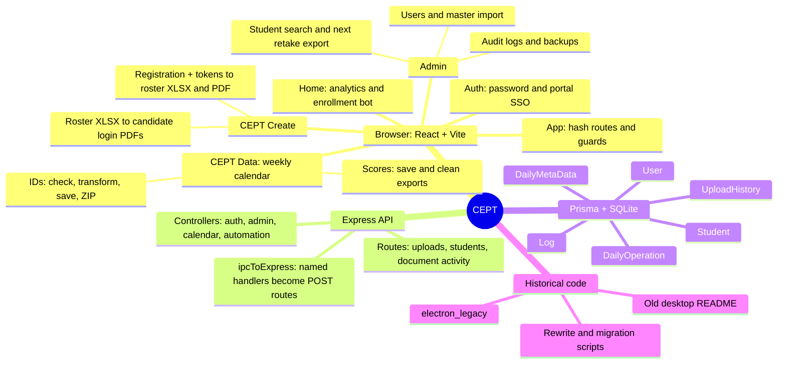

# CEPT project map

Reviewed: 2026-10-27. Scope: local working tree, not just committed main.

## Start here

CEPT helps AAST staff process exam registration IDs and results, prepare location/time rosters and candidate login documents, browse student records, and review daily activity. The code is partway through a desktop-to-browser and MongoDB-to-SQLite migration. A registered endpoint is not proof that its implementation works.

Use this map to select a feature, then consult [the code index](docs/CODE_INDEX.md) for functions and endpoints. Read the selected implementation before making changes.

## Architecture mind map

## Feature-to-file navigation

All paths below are relative to the CEPT root.

| Work area | UI entry | Backend / supporting files |
| --- | --- | --- |
| Boot, routes, access guards | `src/main.jsx`, `src/App.jsx` | `server/src/server.js`, `server/src/app.js` |
| API address and request transport | `src/api.js` | `server/src/ipcToExpress.js`, `controllers/index.js` |
| Password login and SSO | `LoginPage.jsx`, `SSOHandler.jsx`, `context/AuthContext.jsx` | `controllers/authHandlers.js` |
| Dashboard totals and details | `components/HomePage.jsx` | `controllers/adminHandlers.js`: dashboard handlers |
| Weekly operations and skip flags | `components/CeptData.jsx` | `controllers/dataHandlers.js`: week operations and toggle handlers |
| Registration processing | `components/IdsModal.jsx` | `routes/uploadRoutes.js`: check-ids, upsert-ids |
| Scores processing | `components/ScoresModal.jsx` | `routes/uploadRoutes.js`: upsert-scores |
| Roster XLSX / PDF creation | `components/CeptCreate.jsx`: handleCreateTable, generateRosterPdfHtml | `routes/ceptCreateRoutes.js` only records activity |
| Candidate login PDFs | `components/CeptCreate.jsx`: handleGeneratePdf, generateLoginPdfHtml | `routes/ceptCreateRoutes.js` only records activity |
| Master student import | `components/AdminDashboard.jsx`: handleUploadMasterData | `routes/uploadRoutes.js`: 500-row chunk imports |
| Student search and retake export | `components/StudentDatabase.jsx` | `routes/studentRoutes.js`, `utils/nextRegistration.js` |
| User management / backup | `components/AdminDashboard.jsx` | `controllers/adminHandlers.js` |
| Audit filtering and pagination | `components/UserLogs.jsx` | `controllers/adminHandlers.js`: log handlers |
| AAST enrollment automation | `components/HomePage.jsx`: runPlaywrightTest | `controllers/playwrightHandlers.js` |
| Layout, icons, theme | `Layout.jsx`, `Sidebar.jsx`, `WorkspaceUI.jsx`, `ThemeToggle.jsx` | `public/icons.svg`, `src/styles/` |

Backend paths abbreviated above live under `server/src/`; component filenames under `src/components/` unless otherwise shown.

## Main data flows and file contracts

### Master import

Admin reads the first worksheet in the browser, skips its header, and sends batches of 500 rows to `/upload-master-data-chunk`. Positional columns: registration number, last name, first name, score, value. The server upserts Student by registrationNumber. Blank or invalid scores become null. Existing skip flags are preserved. UploadHistory is written for the final chunk; its recordsUpdated currently counts that chunk, not the entire import.

### Daily registration IDs

`CeptData` opens `IdsModal` for a selected test date. The modal reads the first sheet of each uploaded workbook: A=RegNum, B=Name, C=Email, D=Mobile, E=Date, F=Time. It strips a trailing `-R<number>` for lookup, calls `/check-ids`, and rewrites IDs based on whether the base student has a score. Currently a scored base becomes `base-R1`; this flow does not calculate the highest existing retake. `/upsert-ids` saves students and calendar/activity state during processing, before the user exports. Export produces processed workbooks plus a headerless `upload.xlsx` in a ZIP.

### Daily scores

`ScoresModal` reads registration number from A, score from D, value from E, stripping the retake suffix for matching. `/upsert-scores` searches Student by prefix, uses an unscored variant if available, otherwise the descending lexical registration number. It saves scores and calendar/activity state before export. Export strips the suffix in column A and creates one cleaned XLSX or a ZIP for multiple files. Numeric retake ordering and exact family matching differ from the next-registration utility; do not assume they share the same rules.

### Rosters and login documents

`CeptCreate.jsx` owns both workflows, including templates and large embedded image data. Registration input requires row 1 headers `RegNum, Name, Email, Mobile, Date, Time`. Each file gets a location (presets include CS_lab 404 and Maritime_lab 232; custom locations are supported). Token input expects row 2 columns A/B `Login, Portal Password`, with records starting on row 3. Matching uses exact trimmed registration/login text. Missing tokens keep the student with a blank password and show a warning.

Students are grouped by location and time and sorted by name. ExcelJS creates a workbook per location, with a sheet per time. html2pdf creates landscape roster PDFs. Both go into `CEPT_Tables.zip`. Generated table columns are `#, Reg num, Name, Mobile, Date, Time, Location, Username, Password`.

Login PDF generation reads all sheets of supplied roster workbooks, requires `Reg num` and `Name`, groups by Location, and creates one portrait PDF per location with a page per candidate using html2canvas/jsPDF. The PDFs are zipped. `/log-cept-table` and `/log-login-pdfs` record analytics after file writes. The login PDF count currently means location PDFs, not candidate pages.

### Next registration number export

StudentDatabase selects unique base registration numbers across searches/pages (maximum 500) and requests `/admin-next-registration-numbers`. The server queries the whole database, finds the highest numeric exact-family `-R` suffix with BigInt, and returns the next number. Missing families return a conflict. ExcelJS exports a single text-formatted column without a header. Export calculates numbers; it does not reserve or insert them.

### Accounts and analytics

Password login verifies bcrypt. SSO verifies a portal JWT, tracks used token IDs in process memory for 60 seconds, and creates/syncs role/email/avatar. Browser identity is stored in localStorage as `cept_user`; cross-tab storage events synchronize it. Theme uses `cept_theme`. Frontend guards check identity/role. Many server admin handlers identify an admin using the request body's adminUsername; there is no general authenticated session middleware in app.js.

DailyOperation keys by intended test date. DailyMetaData keys by actual activity date, with JSON strings recording intended test dates, per-date maximum file counts, and contributors. Home aggregates those fields. Log contains individual audit events. Dates use several local/UTC conversions; preserve the distinction when changing reports.

## Persistence

`server/prisma/schema.prisma` defines six models: User, Log, DailyOperation, DailyMetaData, Student, UploadHistory. There are no declared model relations. Metadata fields store serialized JSON.

Two different SQLite files exist, inspected read-only for table names only:

- `server/prisma/dev.db`: six application tables plus sqlite_sequence.
- `server/dev.db`: TestUser plus sqlite_sequence; appears to be a scratch database.

The actual runtime database depends on DATABASE_URL. Do not choose by filename alone. `server/.env` exists (ignored by the initial file listing); root `.env` defines MONGO_URI, while server startup explicitly loads `server/.env`. No student records or credential values are reproduced here.

## Runtime and verification

- Frontend: root `npm run dev`, Vite port 5174 (strict). Build: `npm run build`; lint: `npm run lint`.
- Backend: in `server/`, `npm run dev` uses nodemon; `npm start` runs src/server.js. Default port 3000.
- `src/api.js` hardcodes `http://localhost:3000/api`; Vite has no API proxy configured.
- `start_all.bat` launches frontend, backend, and Prisma Studio (5556). Inspect it before use; this review did not launch it.
- Backend package declares Prisma/client 5.22, while prisma.config.ts imports prisma/config; compatibility must be checked when preparing the runtime.
- A dependency-free test exists: `node --test server/test/nextRegistration.test.js`. Passed 1/1 during this review.
- Other server/test*.js and test_api.mjs files are ad hoc scripts; inspect before running because some create records or contact services.
- Full build, lint, UI, SSO, imports, exports, and portal automation were not run during this orientation. No dependencies were installed, migrations performed, or remote services accessed.

## Migration gaps to remember

These are source observations, not a completed bug audit or requested fixes:

1. Original README still documents portable Electron/MongoDB; current scripts start a browser/Express/SQLite app. Root package retains a desktop main entry and older dependencies.
2. AdminDashboard still uses undefined ipcRenderer for manual backup and create/edit/delete user actions. Most other UI paths use axios.
3. AuthContext logout calls `/admin/export-db`, but the registered endpoint is `/admin-export-db`; its backup attempt therefore does not match the server route.
4. dataHandlers is registered in the active server. Some handlers are Prisma-based, but toggle-not-needed still uses undefined DailyOperation, log-frontend-action uses undefined Log, and old export handlers retain undefined DailyMetaData/Mongoose operations.
5. ipcToExpress mocks desktop dialogs as canceled and BrowserWindow as a stub. Ported file-dialog exports cannot be treated as working browser exports.
6. `server/src/routes/authRoutes.js` is not mounted and imports a missing authController.js. Active auth uses the named handlers instead.
7. `server/src/scripts/migrateMongoToSql.js` references missing db/models.js and Prisma models not in the current schema. Rewrite scripts contain hardcoded old workspace paths. They are migration artifacts, not safe setup commands.
8. Silent/manual backup exports only users (without passwords), logs, and dailyOperations; it omits students, DailyMetaData, and UploadHistory. Silent backup writes to a specific institutional OneDrive location and rotates files. It is not a complete recoverable database backup.
9. Retake rules differ among IDs processing, scores matching, and next-number export. The passing utility test does not validate the other workflows.
10. Browser exports depend on showSaveFilePicker; verify support in the intended browser and origin. Document generation can complete before remote activity logging fails.
11. Authentication code includes a fallback SSO secret; legacy/migration code and environment files contain credential material. Do not reproduce values or run migration code casually.
12. Playwright automation opens an institutional portal, waits for manual login, and performs enrollment actions using specific text/capacity selectors. It is an operational feature, not a harmless smoke test.

## Historical and auxiliary material

- `electron_legacy/`: original Electron boot/preload/window, MongoDB connect/models/seed, IPC registration, file locks, document/table generation, Excel VBS formatting, desktop data/auth/admin/automation handlers. Useful for tracing intended older behavior; not the current entry point.
- `server/src/window.js` and controllers/format_excel.vbs: desktop port remnants.
- `server/rewrite_*.py`, `server/temp.js`, `src/scripts/replaceIpc.mjs`, `fix-layout.cjs`: one-off rewriting/migration helpers; inspect instead of rerunning.
- `server/.agents/skills/`: bundled Prisma reference skills, not application behavior or evidence of the installed Prisma version.
- `src/styles/index.scss` loads shared and page partials; `_Workspace.scss` is the broad current visual layer. `_RegistrationExport.scss` is imported by StudentDatabase. Some legacy partials remain.
- `public/`: local Manrope fonts and license, icons, favicons, Cambridge logo. `.git/` and lockfiles are repository/dependency metadata rather than feature code.

## Review boundaries and future maintenance

This is a source-based architecture and workflow orientation, with targeted reads of active behavior, route registration, schema, legacy structure, scripts, and styles. It is not a claim of 100% runtime understanding. Binary image/font payloads, Git object contents, private database rows, and dependency internals were not semantically reviewed. Business rules still need confirmation against real examples when we work on them.

When resuming: read this document, check git status, use CODE_INDEX to locate the feature, reread its source, and validate only the relevant behavior. Update this map when the architecture or file contracts change.
